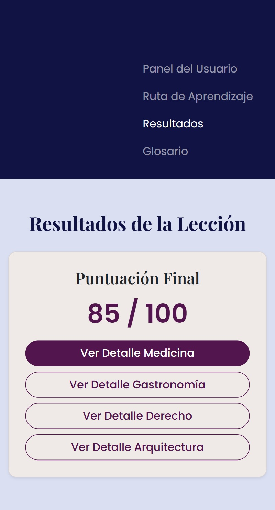
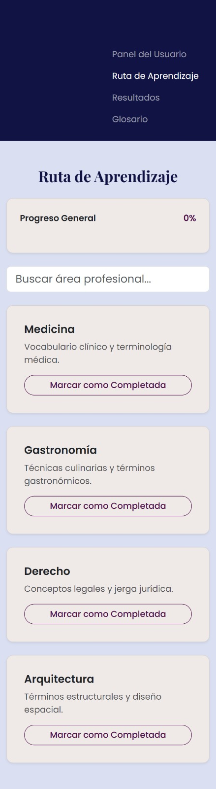

# Shiftly

Shiftly es una app web gamificada de inglés profesional que prepara a trabajadores para laborar en el extranjero. Enseña vocabulario técnico, jerga laboral y modismos corporativos mediante lecciones interactivas, para que los usuarios se comuniquen con confianza y eviten malentendidos en su día a día.

Proyecto de la materia **Aplicaciones Web** (Septiembre–Diciembre 2026): aplicación CRUD con **Laravel 13** y **PostgreSQL**.

---

## Índice

1. [Integrantes del equipo](#integrantes-del-equipo)
2. [Requisitos](#requisitos)
3. [Instalación](#instalación)
4. [Actualizar después de un `git pull`](#actualizar-después-de-un-git-pull)
5. [Panel de contenido (CRUD)](#panel-de-contenido-crud)
6. [Rutas principales](#rutas-principales)
7. [Modelo de datos](#modelo-de-datos)
8. [Validación y seguridad](#validación-y-seguridad)
9. [Pruebas](#pruebas)
10. [Cumplimiento de la rúbrica](#cumplimiento-de-la-rúbrica)
11. [Solución de problemas](#solución-de-problemas)
12. [Flujo de trabajo con Git](#flujo-de-trabajo-con-git)
13. [Tecnologías](#tecnologías)
14. [Características principales](#características-principales)
15. [Estructura del proyecto](#estructura-del-proyecto)
16. [Evidencias de interfaz](#evidencias-de-interfaz)
17. [Historial de integración](#historial-de-integración)
18. [Pendientes y decisiones abiertas](#pendientes-y-decisiones-abiertas)

---

## Integrantes del equipo

| Integrante | Rol |
| --- | --- |
| Luis David Balandrano Delgado | Líder técnico |
| Keydhy Mareli Villa Aldana | Analista |
| Isis Dayane Arellano Carrillo | Frontend |
| Brian Jael Juárez Rodrigues | Frontend |
| Julio Cesar Licona Hernandez | Backend |
| Vaneza Lugo Ramírez | Backend |

---

## Requisitos

- PHP 8.3 o superior con las extensiones `pdo_pgsql` y `pgsql` (y `pdo_sqlite` y `sqlite3` para correr las pruebas)
- Composer 2
- PostgreSQL 14 o superior (el proyecto se probó con PostgreSQL 18)
- Git

> En XAMPP las extensiones se activan en `C:\xampp\php\php.ini` agregando o descomentando:
>
> ```ini
> extension=pdo_pgsql
> extension=pgsql
> extension=pdo_sqlite
> extension=sqlite3
> ```
>
> Después reinicia Apache desde el panel de XAMPP. Para comprobarlo: `php -m` debe listar `pdo_pgsql` y `pdo_sqlite`.

No se necesita Node.js: las vistas cargan Bootstrap desde CDN y no usan Vite.

---

## Instalación

1. **Clonar el repositorio**

   ```bash
   git clone https://github.com/dbB25/ShiftlyLV.git
   cd ShiftlyLV
   ```

2. **Instalar las dependencias de PHP**

   ```bash
   composer install
   ```

3. **Crear el archivo de entorno y la llave de la aplicación**

   ```bash
   cp .env.example .env
   php artisan key:generate
   ```

4. **Crear la base de datos en PostgreSQL** (desde pgAdmin: *Databases → Create → Database*, o con `psql`):

   ```sql
   CREATE DATABASE shiftly;
   ```

   Puedes usar otro nombre (por ejemplo `shiftly_db`); solo pon el mismo en `DB_DATABASE`.

5. **Configurar la conexión en `.env`** con tu usuario y contraseña de PostgreSQL:

   ```env
   DB_CONNECTION=pgsql
   DB_HOST=127.0.0.1
   DB_PORT=5432
   DB_DATABASE=shiftly
   DB_USERNAME=postgres
   DB_PASSWORD=tu_contraseña
   ```

   El archivo `.env` está en `.gitignore` y no se sube al repositorio. Nunca guardes contraseñas reales en `.env.example`.

6. **Crear las tablas y cargar los datos de prueba**

   ```bash
   php artisan migrate --seed
   ```

   Para borrar todo y empezar de cero: `php artisan migrate:fresh --seed`.

7. **Levantar el servidor**

   ```bash
   php artisan serve
   ```

   Abre <http://127.0.0.1:8000>.

### Usuario de prueba

El seeder crea un usuario para entrar al dashboard y al panel de contenido:

| Correo | Contraseña |
| --- | --- |
| `prueba@shiftly.com` | `Password123` |

### Datos que carga el seeder

| Tabla | Registros |
| --- | --- |
| `users` | 1 (usuario de prueba) |
| `areas` | 6 (Sistemas y Software, Medicina y Salud, Gastronomía, Derecho Corporativo, Arquitectura, General) |
| `lecciones` | 6 (una «Introducción a…» por área) |
| `ejercicios` | 6 (uno por lección) |
| `terminos` | 6 (uno por área) |
| `progresos` | 6 (progreso del usuario de prueba en cada lección) |

### Recuperación de contraseña

`.env.example` usa `MAIL_MAILER=log`: el correo con el enlace para restablecer la contraseña no se envía, se escribe en `storage/logs/laravel.log`. Para enviarlo de verdad, configura un servidor SMTP en las variables `MAIL_*` de tu `.env`.

---

## Actualizar después de un `git pull`

Cada vez que traigas cambios de `main`:

```bash
git checkout main
git pull origin main
composer install
php artisan migrate
```

Si cambió la estructura de una tabla que ya tenías (por ejemplo `ejercicios`) o aparece un error de tabla duplicada, reinicia la base:

```bash
php artisan migrate:fresh --seed
```

> `migrate:fresh` borra **todas** las tablas y sus datos antes de volver a crearlas. Úsalo solo en tu base local.

---

## Panel de contenido (CRUD)

Después de iniciar sesión, el panel está en <http://127.0.0.1:8000/gestion/lecciones>. También se llega desde el dashboard (botón **Panel de contenido**) y desde el menú superior del panel.

| Módulo | Ruta | Operaciones |
| --- | --- | --- |
| Lecciones | `/gestion/lecciones` | Crear, listar (10 por página, búsqueda por título y filtro por área), editar y eliminar |
| Ejercicios | `/gestion/ejercicios` | Crear, listar (10 por página, búsqueda por título o pregunta y filtro por lección), editar y eliminar |

- Las rutas usan `Route::resource()` con *route model binding* y están dentro del middleware `auth`.
- Los formularios de crear y editar comparten un parcial `_form.blade.php` y precargan los datos actuales al editar.
- Cada ejercicio pertenece a una lección (campo **Lección** obligatorio).
- La búsqueda no distingue mayúsculas (en PostgreSQL usa `ILIKE`) y se conserva al cambiar de página.
- Al eliminar se abre una ventana de confirmación:
  - una lección con **progreso de estudiantes** no se elimina y se muestra un mensaje;
  - una lección sin progreso se elimina junto con sus ejercicios, y la ventana lo avisa antes.
- Después de crear, editar o eliminar aparece un mensaje de éxito o de error.

---

## Rutas principales

| Método | Ruta | Descripción | Acceso |
| --- | --- | --- | --- |
| GET | `/` | Inicio y selección de área | Público |
| GET / POST | `/registro` | Crear cuenta | Público |
| GET / POST | `/login` | Iniciar sesión | Público |
| POST | `/logout` | Cerrar sesión | Con sesión |
| GET / POST | `/recuperar-password` | Pedir enlace para restablecer la contraseña | Público |
| GET | `/new-password/{token}` | Formulario para restablecer la contraseña | Público |
| POST | `/new-password` | Guardar la nueva contraseña | Público |
| GET / POST | `/contacto` | Formulario de contacto | Público |
| GET | `/servicios` | Vocabulario por sector | Público |
| GET | `/dashboard` | Panel del usuario | Con sesión |
| GET / POST | `/perfil` | Ver y editar el perfil | Con sesión |
| GET | `/diagnostico`, `/resultado`, `/recomendaciones` | Test de nivel y resultados | Con sesión |
| GET | `/ruta-aprendizaje`, `/ruta-{carrera}` | Árboles de lecciones por carrera | Con sesión |
| GET | `/ejercicios`, `/resultados-leccion`, `/glosario` | Práctica, resultados y glosario | Con sesión |
| RESOURCE | `/gestion/lecciones` | CRUD de lecciones | Con sesión |
| RESOURCE | `/gestion/ejercicios` | CRUD de ejercicios | Con sesión |

Lista completa: `php artisan route:list --except-vendor`.

---

## Modelo de datos

| Tabla | Descripción | Relaciones |
| --- | --- | --- |
| `users` | Usuarios de la plataforma (nombre, apellido, carrera, área profesional) | tiene muchos `progresos` |
| `areas` | Áreas profesionales | tiene muchas `lecciones` y `terminos` |
| `lecciones` | Lecciones de cada área, con nivel A1–C2, orden y estado publicada | pertenece a `areas`; tiene muchos `ejercicios` y `progresos` |
| `ejercicios` | Ejercicios de cada lección (completar, opción múltiple, ordenar, emparejar) | pertenece a `lecciones` |
| `terminos` | Glosario de términos por área | pertenece a `areas` |
| `progresos` | Puntaje y avance de cada usuario por lección | pertenece a `users` y `lecciones` |

### Llaves foráneas y política de borrado

| Llave foránea | Al borrar el registro padre | Motivo |
| --- | --- | --- |
| `lecciones.area_id → areas` | `RESTRICT` (no deja borrar el área) | Evita perder lecciones por accidente |
| `ejercicios.leccion_id → lecciones` | `CASCADE` | Un ejercicio no existe sin su lección |
| `terminos.area_id → areas` | `CASCADE` | El glosario depende de su área |
| `progresos.user_id → users` | `CASCADE` | El progreso es del usuario |
| `progresos.leccion_id → lecciones` | `CASCADE` | El progreso es de la lección (el panel bloquea antes ese borrado) |

### Restricciones principales

- `areas`: `nombre` y `slug` únicos (80 caracteres), `activo` boolean con valor por defecto `true`.
- `lecciones`: título único por área (`unique(area_id, titulo)`), `publicada` boolean con valor por defecto `false`.
- `ejercicios`: título único por lección (`unique(leccion_id, titulo)`), `opciones` en `jsonb`.
- `terminos`: término único por área (`unique(area_id, termino)`).
- `progresos`: un registro por usuario y lección (`unique(user_id, leccion_id)`), `puntaje` `decimal(5,2)`.

Las migraciones están en `database/migrations`, las factories en `database/factories` y los datos de prueba en `database/seeders/DatabaseSeeder.php`.

---

## Validación y seguridad

- **FormRequests** separados para crear y editar: `StoreLeccionRequest` / `UpdateLeccionRequest` y `StoreEjercicioRequest` / `UpdateEjercicioRequest`. También `RegistroRequest`, `PerfilRequest` y `ContactoRequest`.
- **Reglas** `required`, `max`, `integer`, `exists`, `Rule::in` y `unique`; al editar, `unique` ignora el registro actual.
- **Mensajes** de error personalizados en español, mostrados junto a cada campo con `@error`; los datos escritos se conservan con `old()`.
- **Asignación masiva protegida:** los modelos declaran `$fillable` y los controladores guardan solo `$request->validated()`.
- **CSRF:** todos los formularios que se envían al servidor incluyen `@csrf`, y `@method('PUT')` / `@method('DELETE')` donde corresponde.
- **Salida escapada** con `{{ }}`; no se usa `{!! !!}` con datos del usuario.
- **Consultas** con Eloquent y parámetros enlazados; no hay SQL concatenado.
- **Contraseñas** guardadas con hash (`'password' => 'hashed'` en el modelo `User`).
- **Rutas privadas** dentro del middleware `auth`; al iniciar sesión se regenera la sesión y al cerrarla se invalida.

---

## Pruebas

```bash
php artisan test
```

Hay **48 pruebas** (143 aserciones) en `tests/Feature`:

| Archivo | Qué comprueba |
| --- | --- |
| `GestionLeccionesTest.php` | Acceso solo con sesión, paginación, búsqueda, crear, validación en español, título único, editar y eliminar (con y sin progreso) |
| `GestionEjerciciosTest.php` | Paginación, búsqueda y filtro por lección, crear con opciones, validación, `old()`, editar y eliminar |
| `RegistroTest.php` | Registro con carrera, correo repetido y carrera inválida |
| `RutasTest.php` | Que todas las páginas cargan y traen sus scripts |

Las pruebas usan SQLite en memoria (ver `phpunit.xml`), así que no tocan tu base de PostgreSQL. Necesitan la extensión `pdo_sqlite`.

---

## Cumplimiento de la rúbrica

| Criterio | Dónde se ve |
| --- | --- |
| 1. Base de datos PostgreSQL y migraciones (20 %) | `.env.example`, `database/migrations`, modelos en `app/Models`, `DatabaseSeeder` |
| 2. Funcionalidad CRUD desde formularios (30 %) | `/gestion/lecciones` y `/gestion/ejercicios`, `LeccionController`, `EjercicioController` |
| 3. Validación de datos y seguridad (20 %) | `app/Http/Requests`, `@csrf` / `@method` en las vistas de `resources/views/gestion` |
| 4. Arquitectura MVC y enrutamiento (15 %) | `routes/web.php`, `resources/views/layouts/app.blade.php`, parciales `_form.blade.php` |
| 5. Interfaz de usuario y retroalimentación (15 %) | Formularios del panel, `partials/alertas.blade.php`, `partials/confirmar-eliminar.blade.php`, `public/css/gestion.css` |

---

## Solución de problemas

| Síntoma | Causa | Solución |
| --- | --- | --- |
| `could not find driver` | Falta la extensión de PHP | Activa `pdo_pgsql` (app) o `pdo_sqlite` (pruebas) en `php.ini` y reinicia Apache |
| `password authentication failed for user "postgres"` | Contraseña incorrecta en `.env` | Revisa `DB_USERNAME` y `DB_PASSWORD`; luego `php artisan config:clear` |
| `database "shiftly" does not exist` | No se creó la base | Créala en pgAdmin con el mismo nombre que `DB_DATABASE` |
| `relation "..." already exists` o columnas que no coinciden | Tu base tiene tablas de una versión anterior | `php artisan migrate:fresh --seed` |
| `No application encryption key has been specified` | Falta `APP_KEY` | `php artisan key:generate` |
| Los cambios del `.env` no se aplican | Configuración en caché | `php artisan config:clear` |
| `vendor/autoload.php` no existe | Faltan dependencias | `composer install` |
| Una página redirige al login | La ruta es privada | Inicia sesión con el usuario de prueba |

---

## Flujo de trabajo con Git

1. Antes de empezar, actualiza `main`: `git checkout main` y `git pull origin main`.
2. Crea una rama para tu tarea: `git checkout -b feature/nombre-de-la-tarea`.
3. Haz commits pequeños con tu propia cuenta y mensajes claros.
4. Antes de abrir el PR, vuelve a traer `main` (`git pull origin main`) y resuelve los conflictos en tu rama.
5. Comprueba que no queden marcas de conflicto (`<<<<<<<`, `=======`, `>>>>>>>` o líneas sueltas con el nombre de una rama) y que `php artisan test` y `php artisan migrate:fresh --seed` terminen sin errores.
6. Abre el PR hacia `main` con una descripción de qué cambió y cómo probarlo.

No subas `.env`, archivos `.bak`, la base de datos SQLite ni archivos temporales del editor (`storage/framework/lsp-*`); ya están en `.gitignore`.

---

## Tecnologías

- **Laravel 13** (PHP 8.3+): rutas, controladores, Eloquent, migraciones, FormRequests y Blade
- **PostgreSQL**: base de datos
- **Bootstrap 5.3** y **Bootstrap Icons 1.11**: diseño responsivo
- **JavaScript (ES6+)**: interactividad de lecciones, diagnóstico y progreso
- **PWA**: `public/manifest.webmanifest` y `public/sw.js` para instalar la app
- **Google Fonts**: Plus Jakarta Sans, Poppins y Playfair Display
- **PHPUnit**: pruebas automatizadas

---

## Características principales

- **Selección de área profesional:** Sistemas, Medicina, Gastronomía, Derecho, Arquitectura y General.
- **Diagnóstico:** test de nivel con resultado y recomendaciones de estudio.
- **Práctica gamificada:** ejercicios con banco de palabras, opción múltiple, emparejamiento y completar frases.
- **Árboles de lecciones por carrera:** avance, XP y lecciones personalizadas guardadas en el navegador.
- **Dashboard:** racha diaria, progreso general, desglose por área y datos reales de la cuenta.
- **Glosario por sectores:** tarjetas de repaso con traducción, ejemplos y pronunciación.
- **Autenticación:** registro con carrera, inicio de sesión, recuperación de contraseña y verificación de correo.
- **Perfil de usuario:** edición de nombre, apellido y área profesional guardada en la base de datos.
- **Contacto:** formulario con validación y mapa de ubicación.
- **Panel de contenido:** CRUD de lecciones y ejercicios guardados en PostgreSQL.

---

## Estructura del proyecto

```text
app/
├── Http/Controllers/       # LeccionController, EjercicioController, Login, Registro, Perfil, Contacto, RecuperarPassword
├── Http/Requests/          # Store/Update de lecciones y ejercicios, Registro, Perfil y Contacto
├── Models/                 # User, Area, Leccion, Ejercicio, Termino, Progreso
└── Providers/              # AppServiceProvider (paginación con Bootstrap 5)
database/
├── factories/              # Datos falsos para pruebas
├── migrations/             # Estructura de las tablas
└── seeders/                # Datos de prueba
public/
├── css/                    # Estilos por página (gestion.css para el panel)
├── js/                     # Lógica de lecciones, diagnóstico, progreso y PWA
└── img/                    # Logotipo, capturas e íconos de la PWA
resources/views/
├── layouts/app.blade.php   # Layout base del panel de contenido
├── partials/               # Alertas y ventana de confirmación de eliminación
├── gestion/lecciones/      # index, create, edit y _form
├── gestion/ejercicios/     # index, create, edit y _form
└── html/                   # Páginas públicas, autenticación y dashboard
routes/web.php              # Rutas de la aplicación
tests/Feature/              # Pruebas del CRUD, del registro y de las rutas
tools/generar-rutas/        # Generador en Python de las vistas, CSS y JS de las rutas por carrera
```

---

## Evidencias de interfaz

| Interfaz | Descripción |
| --- | --- |
|  | **Panel del usuario:** acceso rápido a los módulos de aprendizaje, resultados y datos de la cuenta. |
|  | **Test de diagnóstico:** preguntas de opción múltiple para estimar el nivel de inglés. |
|  | **Biblioteca y repaso técnico:** vocabulario por sector con buscador y filtros. |
|  | **Ruta de aprendizaje y recomendaciones:** siguiente lección recomendada y progreso. |
|  | **Resultados del diagnóstico:** nivel estimado y recomendación. |
|  | **Resultados de la lección:** puntuación y detalle por sector. |
|  | **Ruta por áreas:** áreas disponibles y seguimiento del avance. |

---

## Historial de integración

| PR / rama | Aporte |
| --- | --- |
| #22 `feature/interfaz-usuario-retroalimentacion` | Formularios con etiquetas, `*` en obligatorios, errores por campo con `@error`, `old()`, alertas globales y botones Cancelar/Volver |
| #18 `feature/crud-ejercicios-pr` | Primer CRUD de ejercicios y corrección de la navegación del diagnóstico hacia las rutas de Laravel |
| #19 `feature/registro-cuentas` | FormRequests, registro, inicio de sesión y perfil conectados a sus controladores; campo de área profesional |
| #21 `validacion-recuperacion` | Actualización de `composer.lock` |
| #23 `feature/postgresql-migrations-pr2` (incluye #20) | Configuración de PostgreSQL; tablas `areas`, `lecciones`, `terminos`, `ejercicios` y `progresos`; modelos con relaciones, factories y seeder; campo `carrera` |
| `fix/conflictos-merge` | Corrección de conflictos de merge; una sola migración de ejercicios ligada a lecciones; CRUD de lecciones; paginación y búsqueda; FormRequests de crear/editar; layout Blade; pruebas; este README |

Durante la integración se quitaron funciones que no guardaban en la base de datos o no pertenecían al proyecto: el administrador de cuentas del login (usaba `localStorage` y mostraba contraseñas), el formulario de perfil simulado del dashboard (ahora muestra los datos reales y enlaza a `/perfil`) y un CRUD de productos ajeno a Shiftly.

---

## Pendientes y decisiones abiertas

- **`carrera` y `area_profesional`:** la tabla `users` tiene las dos columnas y guardan un dato parecido (el registro usa `carrera`; el perfil, `area_profesional`). Conviene unificarlas en una sola, idealmente como llave foránea a `areas`.
- **Layout en las páginas anteriores:** el panel de contenido usa `layouts/app.blade.php`; las páginas públicas, de autenticación y del dashboard todavía tienen su propio HTML completo.
- **Progreso del juego:** el avance de los árboles de lecciones, el diagnóstico y las lecciones personalizadas se guarda en `localStorage`; la tabla `progresos` ya existe para pasarlo a la base de datos.
- **Verificación de correo:** la pantalla funciona en el navegador, pero todavía no valida el código contra el servidor.
