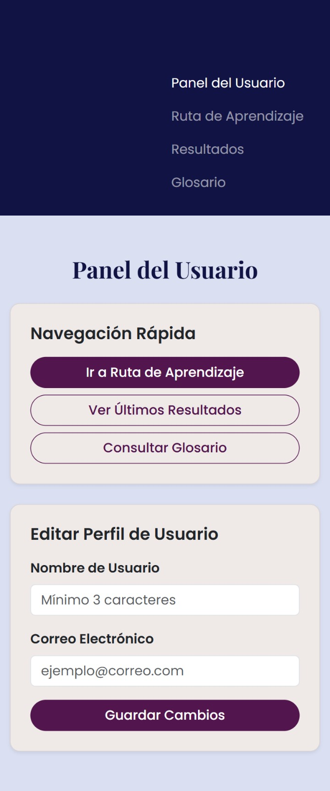
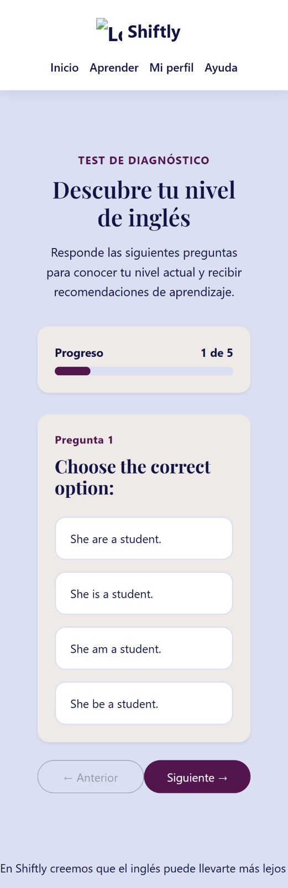
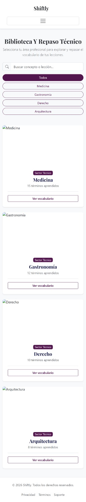

# Shiftly

Shiftly es una app web gamificada de inglés profesional que prepara a trabajadores para laborar en el extranjero. Enseña vocabulario técnico, jerga laboral y modismos corporativos mediante lecciones interactivas, para que los usuarios se comuniquen con confianza y eviten malentendidos en su día a día.

Proyecto de la materia **Aplicaciones Web** (Septiembre–Diciembre 2026): aplicación CRUD con **Laravel** y **PostgreSQL**.

---

## Integrantes del equipo

| Integrante | Rol |
| --- | --- |
| Luis David Balandrano Delgado | Líder técnico |
| Keydhy Mareli Villa Aldana | Analista |
| Isis Dayane Arellano Carrillo | Frontend |
| Brian Jael Juárez Rodrigues | Frontend |
| Julio Cesar Licona Hernandez | Backend |
| Vaneza Lugo Ramírez | Backend |

---

## Requisitos

- PHP 8.3 o superior con las extensiones `pdo_pgsql` y `pgsql` activas (y `pdo_sqlite` para correr las pruebas)
- Composer 2
- PostgreSQL 14 o superior
- Git

> En XAMPP las extensiones se activan en `C:\xampp\php\php.ini` agregando o descomentando:
> `extension=pdo_pgsql`, `extension=pgsql`, `extension=pdo_sqlite` y `extension=sqlite3`.
> Después reinicia Apache.

---

## Instalación

1. **Clonar el repositorio**

   ```bash
   git clone https://github.com/dbB25/ShiftlyLV.git
   cd ShiftlyLV
   ```

2. **Instalar las dependencias de PHP**

   ```bash
   composer install
   ```

3. **Crear el archivo de entorno y la llave de la aplicación**

   ```bash
   cp .env.example .env
   php artisan key:generate
   ```

4. **Crear la base de datos en PostgreSQL** (desde pgAdmin o con `psql`):

   ```sql
   CREATE DATABASE shiftly;
   ```

5. **Configurar la conexión en `.env`** con tu usuario y contraseña de PostgreSQL:

   ```env
   DB_CONNECTION=pgsql
   DB_HOST=127.0.0.1
   DB_PORT=5432
   DB_DATABASE=shiftly
   DB_USERNAME=postgres
   DB_PASSWORD=tu_contraseña
   ```

   El archivo `.env` no se sube al repositorio; nunca guardes contraseñas reales en `.env.example`.

6. **Crear las tablas y cargar los datos de prueba**

   ```bash
   php artisan migrate --seed
   ```

   Para borrar todo y empezar de cero: `php artisan migrate:fresh --seed`.

7. **Levantar el servidor**

   ```bash
   php artisan serve
   ```

   Abre <http://127.0.0.1:8000>.

### Usuario de prueba

El seeder crea un usuario para entrar al dashboard y al panel de contenido:

| Correo | Contraseña |
| --- | --- |
| `prueba@shiftly.com` | `Password123` |

---

## Panel de contenido (CRUD)

Después de iniciar sesión, el panel de contenido está en <http://127.0.0.1:8000/gestion/lecciones>.

| Módulo | Ruta | Operaciones |
| --- | --- | --- |
| Lecciones | `/gestion/lecciones` | Crear, listar (paginación, búsqueda por título y filtro por área), editar y eliminar |
| Ejercicios | `/gestion/ejercicios` | Crear, listar (paginación, búsqueda por título o pregunta y filtro por lección), editar y eliminar |

- Las rutas usan `Route::resource()` con *route model binding* y están protegidas con el middleware `auth`.
- La validación vive en FormRequests separados para crear y editar (`StoreLeccionRequest`, `UpdateLeccionRequest`, `StoreEjercicioRequest`, `UpdateEjercicioRequest`) con mensajes en español.
- Al eliminar se pide confirmación. Una lección con progreso de estudiantes no se elimina (se muestra un mensaje); si solo tiene ejercicios, se eliminan junto con ella.

---

## Modelo de datos

| Tabla | Descripción | Relaciones |
| --- | --- | --- |
| `users` | Usuarios de la plataforma | tiene muchos `progresos` |
| `areas` | Áreas profesionales (Sistemas, Medicina, Gastronomía, Derecho, Arquitectura, General) | tiene muchas `lecciones` y `terminos` |
| `lecciones` | Lecciones de cada área, con nivel A1–C2 | pertenece a `areas` (`restrictOnDelete`); tiene muchos `ejercicios` y `progresos` |
| `ejercicios` | Ejercicios de cada lección (completar, opción múltiple, ordenar, emparejar) | pertenece a `lecciones` (`cascadeOnDelete`) |
| `terminos` | Glosario de términos por área | pertenece a `areas` (`cascadeOnDelete`) |
| `progresos` | Puntaje y avance de cada usuario por lección | pertenece a `users` y `lecciones` (`cascadeOnDelete`) |

Las migraciones están en `database/migrations` y los datos de prueba en `database/seeders/DatabaseSeeder.php`.

---

## Pruebas

```bash
php artisan test
```

Las pruebas usan SQLite en memoria (ver `phpunit.xml`), así que no tocan tu base de PostgreSQL.

---

## Tecnologías

- **Laravel 13** (PHP 8.3+): rutas, controladores, Eloquent, migraciones, FormRequests y Blade
- **PostgreSQL**: base de datos
- **Bootstrap 5.3** y **Bootstrap Icons 1.11**: diseño responsivo
- **JavaScript (ES6+)**: interactividad de lecciones, diagnóstico y progreso
- **Google Fonts**: Plus Jakarta Sans, Poppins y Playfair Display

---

## Características principales

- **Selección de área profesional:** Sistemas, Medicina, Gastronomía, Derecho, Arquitectura y General.
- **Diagnóstico:** test de nivel con resultado y recomendaciones de estudio.
- **Práctica gamificada:** ejercicios con banco de palabras, opción múltiple, emparejamiento y completar frases.
- **Dashboard:** racha diaria, progreso general y desglose por área.
- **Glosario por sectores:** tarjetas de repaso con traducción, ejemplos y pronunciación.
- **Autenticación:** registro, inicio de sesión, recuperación de contraseña y verificación de correo.
- **Perfil de usuario:** edición de datos personales y área profesional.
- **Contacto:** formulario con validación y mapa de ubicación.
- **Panel de contenido:** CRUD de lecciones y ejercicios guardados en PostgreSQL.

---

## Estructura del proyecto

```text
app/
├── Http/Controllers/     # LeccionController, EjercicioController, Login, Registro, Perfil, Contacto...
├── Http/Requests/        # Validaciones (Store/Update de lecciones y ejercicios, registro, perfil, contacto)
└── Models/               # User, Area, Leccion, Ejercicio, Termino, Progreso
database/
├── factories/
├── migrations/
└── seeders/
public/                   # CSS, JS, imágenes y PWA
resources/views/
├── layouts/app.blade.php # Layout base del panel de contenido
├── partials/             # Alertas y confirmación de eliminación
├── gestion/lecciones/    # index, create, edit y _form
├── gestion/ejercicios/   # index, create, edit y _form
└── html/                 # Páginas públicas, autenticación y dashboard
routes/web.php            # Rutas de la aplicación
tests/Feature/            # Pruebas de rutas y del CRUD
```

---

## Evidencias de interfaz

| Interfaz | Descripción |
| --- | --- |
|  | **Panel del usuario:** acceso rápido a los módulos de aprendizaje, resultados y edición del perfil. |
|  | **Test de diagnóstico:** preguntas de opción múltiple para estimar el nivel de inglés. |
|  | **Biblioteca y repaso técnico:** vocabulario por sector con buscador y filtros. |
|  | **Ruta de aprendizaje y recomendaciones:** siguiente lección recomendada y progreso. |
|  | **Resultados del diagnóstico:** nivel estimado y recomendación. |
|  | **Resultados de la lección:** puntuación y detalle por sector. |
|  | **Ruta por áreas:** áreas disponibles y seguimiento del avance. |

---

## Aportaciones por rama

- **`feature/interfaz-usuario-retroalimentacion`:** formularios con etiquetas, `*` en obligatorios, errores por campo con `@error`, `old()`, alertas globales y botones Cancelar/Volver.
- **`feature/crud-ejercicios-pr`:** primer CRUD de ejercicios y corrección de la navegación del diagnóstico hacia las rutas de Laravel.
- **`feature/registro-cuentas`:** registro, inicio de sesión, perfil y campo de área profesional.
- **`feature/postgresql-migrations-pr2`:** configuración de PostgreSQL, tablas `areas`, `lecciones`, `terminos`, `ejercicios` y `progresos`, modelos con relaciones y seeder.
- **`fix/conflictos-merge`:** corrección de conflictos de merge, CRUD de lecciones, layout Blade, paginación y búsqueda, FormRequests de crear/editar y este README.
